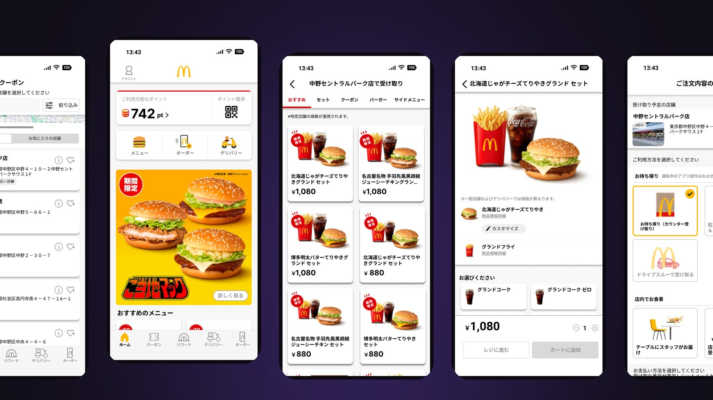

# McDonald's App Trace

Figmaで制作した、マクドナルド公式アプリの非公式な学習用UIトレース。

[作品を見る](https://eisuke29.github.io/portfolio/work8.html) · [ポートフォリオ](https://eisuke29.github.io/portfolio/)

## プロトタイプ

ゼミのFigma入門課題として、既存アプリの見た目と画面遷移の再現を目指しました。30画面を制作し、タブ切替・店舗選択・商品選択・注文確認などをつないでいます。2026年5月26日発表の個人制作。

- [Figmaプロトタイプを操作する](https://www.figma.com/proto/EruDPWL0RaFiqDk5ayh19N/?node-id=1-4108&starting-point-node-id=1%3A4108&scaling=scale-down)
- [Figmaデザイン](https://www.figma.com/design/EruDPWL0RaFiqDk5ayh19N/)
- [操作録画（MP4）](media/prototype-demo.mp4)
- `media/`：主要画面と操作例

学習目的の非公式な再現で、日本マクドナルド株式会社とは関係ありません。ロゴ・商品写真・店舗情報等の権利は各権利者に帰属します。公式アプリや注文サービスとしては利用できません。

## 制作者・権利

木下瑛介 / Eisuke Kinoshita（[Eisuke29](https://github.com/Eisuke29)）。共同制作・外部素材については上記の説明を参照してください。自作のコード・映像・デザインについて、別途記載のない限り無断での再配布は許諾していません。外部ライブラリ・モデル・フォント等にはそれぞれのライセンスが適用されます。
